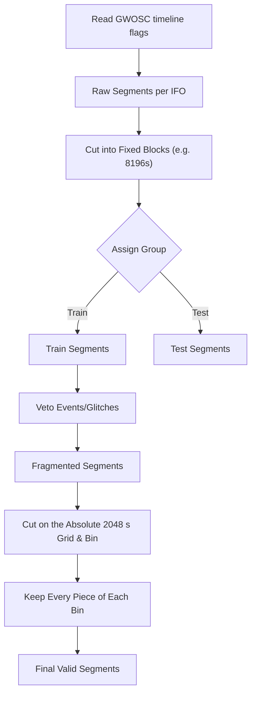

# Gravyflow Acquisition Process

This document provides a detailed explanation of the data acquisition process in `gravyflow`, specifically focusing on how the `IFODataObtainer` selects, splits, and groups time segments for noise and feature acquisition.

## High-Level Overview

The acquisition process is designed to retrieve valid, high-quality data segments from gravitational wave detectors (IFOs) like LIGO. The process ensures that:
1.  Data is available for all requested detectors simultaneously (coincident time).
2.  Data meets specific quality criteria (state flags).
3.  Segments are split into manageable chunks for training, validation, and testing.
4.  Unwanted periods (glitches, known events) are vetoed or handled appropriately.
5.  For noise acquisition, long segments are prioritized to maximize the number of background samples.

## The Segment Selection Pipeline

The core logic resides in the `get_valid_segments` method of the `IFODataObtainer` class. Here is the step-by-step flow:

### 1. Initial Retrieval (`get_all_segment_times`)
The process begins by reading the public GWOSC timeline for each requested interferometer (e.g., H1, L1). No LVK credentials are needed.
-   **Input**: The GPS bounds of each observing run, from the GWOSC run API (O3 is GWOSC's O3a plus O3b), the detector (IFO), and the GWOSC flags to apply.
-   **Flags**: GWOSC defines each data-quality flag as the times that *pass* it, so applying a category means intersecting with its flag. The default (`gf.DEFAULT_GWOSC_FLAGS`) is `DATA` with `BURST_CAT1` and `BURST_CAT2` applied and without hardware injections: `NO_CBC_HW_INJ` ("no cbc injection"), `NO_BURST_HW_INJ` ("no burst injections"), `NO_STOCH_HW_INJ` ("no stoch injections") and `NO_DETCHAR_HW_INJ` ("no detchar injections") list the times with no injection, so they are intersected too (`gf.GWOSC_NO_HW_INJECTION_FLAGS`). The stochastic injections are coherent between H1 and L1. `NO_CW_HW_INJ` is not applied: continuous-wave injections run through nearly all of every run. `gwosc_flags=gf.GWOSC_BURST_FLAGS`, `gf.GWOSC_DATA_FLAGS` or `gf.GWOSC_CBC_FLAGS` selects others.
-   **Operation**: Returns a sorted, coalesced list of `[start, end)` time pairs where the detector passes every flag, over every configured run in any order.
-   **Cache**: Timeline segments are cached in `~/.gravyflow/cache/gwosc_timeline` (or `$GRAVYFLOW_CACHE_DIR`).
-   **Result**: A list of valid segments for *one* detector.

Livetime per option (days), measured from the GWOSC timeline:

| Run | IFO | `DATA` | `+BURST_CAT1` | `+BURST_CAT2` | `+NO_*_HW_INJ` (default) | default, after event and glitch vetoes | `DATA+CBC_CAT1+CBC_CAT2` |
|---|---|---|---|---|---|---|---|
| O1 | H1 | 76.70 | 76.70 | 76.22 | 76.19 | 75.59 | 75.89 |
| O1 | L1 | 65.81 | 65.81 | 65.78 | 65.75 | 64.39 | 65.80 |
| O2 | H1 | 157.81 | 157.81 | 157.24 | 157.22 | 155.37 | 157.38 |
| O2 | L1 | 153.96 | 153.96 | 153.56 | 153.55 | 150.37 | 153.72 |
| O3 | H1 | 245.21 | 245.21 | 243.53 | 243.53 | 237.33 | 244.70 |
| O3 | L1 | 251.93 | 251.93 | 250.47 | 250.47 | 240.86 | 251.47 |

Strain comes from local frames when a frame server is configured, and otherwise from GWOSC through `TimeSeries.fetch_open_data`, at 4096 Hz when that suffices and at 16384 Hz otherwise. Sample rates above 16384 Hz are refused: real data is never upsampled.

### Glitch catalogue

Glitch times, classes and metadata (SNR, peak frequency, duration, confidence) come from the public Gravity Spy machine-learning classifications: Glanzer et al. 2023, *Class. Quantum Grav.* 40 065004, released on Zenodo (doi:10.5281/zenodo.5649212, v1.0.0, CC-BY-4.0). Please cite both if you use glitches from gravyflow. Each detector and run's file (16 to 216 MB) is downloaded on first use, checked against its published md5, and cached in compact form in `~/.gravyflow/cache/gravityspy`. The defaults keep every class except `No_Glitch`, with `ml_confidence >= 0.9`. Entries that overlap a catalogued GW event's in-band signal are removed (`exclude_events=True`): Gravity Spy lists some real events as glitches, for example GW190521 (Blip_Low_Frequency) and GW200129_065458 (Chirp).

### Event catalogue

Event times and source-frame chirp masses come from every GWTC catalogue on GWOSC (confident, marginal and auxiliary releases, the cumulative GWTC table and GWTC-4.0), fetched once and cached in `~/.gravyflow/cache/gwosc_events` (`gf.get_event_catalogue`).

### 2. Coincidence and Cutting (`cut_segments`)
To train a model on multi-detector data, we need times where *all* detectors were active.
-   **Splitting**: Before finding intersections, segments are often split into smaller, fixed-duration chunks (e.g., 8196 seconds) to facilitate consistent grouping later.
-   **Operation**: The `cut_segments` method takes long continuous segments and chops them into these fixed-size blocks.

### 3. Group Assignment (`get_segments_for_group`)
Data is deterministically assigned to `train`, `validate`, or `test` groups to ensure no leakage between them.
-   **Logic**: The timeline is divided into blocks (e.g., 8196s). Each block is hashed or assigned based on its time to a specific group.
-   **Example**: If the split is 98% train, 1% validate, 1% test, then for every 100 blocks, 98 go to training.
-   **Result**: A filtered list of segments that belong *only* to the requested group (e.g., "train").

### 4. Vetoing Unwanted Times (`remove_unwanted_segments`)
Unless the data labels include them, every catalogued GW event and every Gravity Spy glitch is removed from noise, over every configured run.
-   **Events** (`get_event_veto_segments`): each event's whole signal in band, `[t - 1.25 tau - 2 s, t + 2 s]`, where `tau` is the leading-order time from 20 Hz to merger for the event's source-frame chirp mass (an upper bound on the observed duration). GW170817 is vetoed from 208 s before its merger. The factor 1.25 makes every catalogued event's veto at least as long as LALSuite's chirp-time bound at maximal spins. Events without published masses are treated as a 1 + 1 solar-mass binary (about 6 minutes). Confident, marginal and auxiliary events are all vetoed.
-   **Glitches** (`get_glitch_veto_segments`): every Gravity Spy entry, whatever its class or classification confidence (each is an Omicron trigger above SNR 7.5), over its whole Omicron extent `[start_time, start_time + duration]` plus 1 s on each side, 3 s for Extremely_Loud. Measured in public strain on 2,535 glitches of every class, the excess power reaches beyond the Omicron extent by at most 0.44 s for 99% of glitches and 1.0 s for 99.9%; only Extremely_Loud glitches reached further, up to 2.5 s.
-   **Operation** (`veto_time_segments`): the veto list is sorted and coalesced, then subtracted from the segments, splitting a segment where a veto falls inside it.

### 5. Noise Acquisition Specifics (`cut_segments`, `merge_bins` & `all_segments_per_bin`)
-   **Binning**: Segments are cut on an absolute grid of `max_segment_duration_seconds` (2048 s by default): bin k is `[2048 k, 2048 (k + 1))` in GPS, whatever runs are configured. A contiguous stretch of data therefore yields whole 2048 s segments.
-   **Merging (`merge_bins`)**: Each detector's pieces are grouped into these bins; bins where some requested detector has no data are dropped.
-   **Selection (`all_segments_per_bin`)**: Every piece of every bin is kept. A bin whose detectors have different numbers of pieces gives as many rows as the detector with the most; each detector's pieces are paired longest first, and a detector with fewer pieces repeats its own.
-   **Result**: An array of shape `(rows, detectors, 2)` of `[start, end]` pairs.

### Loading segments
Each segment's strain is fetched whole, from its first sample: nothing is trimmed from its start, and its end is cut to a whole number of seconds, so the number of distinct segment lengths stays bounded. On the GWOSC timeline (O1 to O3, H1 and L1, each detector alone, at 2048 Hz), the noise available in pieces of at least 36 s rose from 9,458 h to 21,275 h, with the event and glitch vetoes now applied (with them applied to the previous binning, 5,780 h).

### 6. Final Ordering (`order_segments`)
Finally, the segments are ordered based on the user's preference:
-   **Random**: Shuffled for training variety.
-   **Chronological**: Useful for sequential analysis.
-   **Shortest First**: Sometimes used for debugging.

## Summary Diagram

This rigorous process ensures that the data fed into the machine learning model is clean, consistent, and strictly separated by dataset split.
