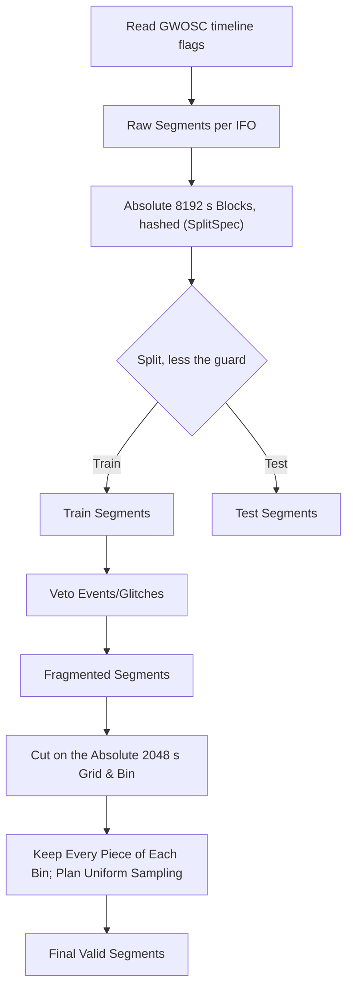

# Gravyflow Acquisition Process

This document provides a detailed explanation of the data acquisition process in `gravyflow`, specifically focusing on how the `IFODataObtainer` selects and splits time segments for noise and feature acquisition.

## High-Level Overview

The acquisition process is designed to retrieve valid, high-quality data segments from gravitational wave detectors (IFOs) like LIGO. The process ensures that:
1.  Every requested detector has data in the same 2048 s bin. Detectors are not intersected: in `RANDOM` order each example's detector windows start at least two footprints apart (`separated_starts`), so their data is never coincident in time.
2.  Data meets specific quality criteria (state flags).
3.  Time is split into train, validate and test by one absolute split, with a guard between splits.
4.  Unwanted periods (glitches, known events) are vetoed or handled appropriately.
5.  For noise acquisition, every usable piece of data is used, and each detector's windows are drawn uniformly over its usable time in each bin.

## The Segment Selection Pipeline

The core logic resides in the `get_valid_segments` method of the `IFODataObtainer` class. Here is the step-by-step flow:

### 1. Initial Retrieval (`get_all_segment_times`)
The process begins by reading the public GWOSC timeline for each requested interferometer (e.g., H1, L1). No LVK credentials are needed.
-   **Input**: The GPS bounds of each observing run, from the GWOSC run API (O3 is GWOSC's O3a plus O3b), the detector (IFO), and the GWOSC flags to apply.
-   **Flags**: GWOSC defines each data-quality flag as the times that *pass* it, so applying a category means intersecting with its flag. The default (`gf.DEFAULT_GWOSC_FLAGS`) is `DATA` with `BURST_CAT1` and `BURST_CAT2` applied and without hardware injections: `NO_CBC_HW_INJ` ("no cbc injection"), `NO_BURST_HW_INJ` ("no burst injections"), `NO_STOCH_HW_INJ` ("no stoch injections") and `NO_DETCHAR_HW_INJ` ("no detchar injections") list the times with no injection, so they are intersected too (`gf.GWOSC_NO_HW_INJECTION_FLAGS`). The stochastic injections are coherent between H1 and L1. `NO_CW_HW_INJ` is not applied: continuous-wave injections run through nearly all of every run. `gwosc_flags=gf.GWOSC_BURST_FLAGS`, `gf.GWOSC_DATA_FLAGS` or `gf.GWOSC_CBC_FLAGS` selects others.
-   **Operation**: Returns a sorted, coalesced list of `[start, end)` time pairs where the detector passes every flag, over every configured run in any order.
-   **Cache**: Timeline segments are cached in `~/.gravyflow/cache/gwosc_timeline` (or `$GRAVYFLOW_CACHE_DIR`).
-   **Result**: A list of valid segments for *one* detector.

Livetime per option (days), measured from the GWOSC timeline:

| Run | IFO | `DATA` | `+BURST_CAT1` | `+BURST_CAT2` | `+NO_*_HW_INJ` (default) | default, after event and glitch vetoes | `DATA+CBC_CAT1+CBC_CAT2` |
|---|---|---|---|---|---|---|---|
| O1 | H1 | 76.70 | 76.70 | 76.22 | 76.19 | 75.59 | 75.89 |
| O1 | L1 | 65.81 | 65.81 | 65.78 | 65.75 | 64.39 | 65.80 |
| O2 | H1 | 157.81 | 157.81 | 157.24 | 157.22 | 155.37 | 157.38 |
| O2 | L1 | 153.96 | 153.96 | 153.56 | 153.55 | 150.37 | 153.72 |
| O3 | H1 | 245.21 | 245.21 | 243.53 | 243.53 | 237.33 | 244.70 |
| O3 | L1 | 251.93 | 251.93 | 250.47 | 250.47 | 240.86 | 251.47 |

Strain comes from local frames when a frame server is configured, and otherwise from GWOSC through `TimeSeries.fetch_open_data`, at 4096 Hz when that suffices and at 16384 Hz otherwise. Sample rates above 16384 Hz are refused: real data is never upsampled.

### Glitch catalogue

Glitch times, classes and metadata (SNR, peak frequency, duration, confidence) come from the public Gravity Spy machine-learning classifications: Glanzer et al. 2023, *Class. Quantum Grav.* 40 065004, released on Zenodo (doi:10.5281/zenodo.5649212, v1.0.0, CC-BY-4.0). Please cite both if you use glitches from gravyflow. Each detector and run's file (16 to 216 MB) is downloaded on first use, checked against its published md5, and cached in compact form in `~/.gravyflow/cache/gravityspy`. The defaults keep every class except `No_Glitch`, with `ml_confidence >= 0.9`. Entries that overlap a published GW event's in-band signal are removed (`exclude_events=True`): Gravity Spy lists some real events as glitches, for example GW190521 (Blip_Low_Frequency) and GW200129_065458 (Chirp). Entries that overlap a hardware-injection gap (times with data that fail `NO_CBC_HW_INJ`, `NO_BURST_HW_INJ`, `NO_STOCH_HW_INJ` or `NO_DETCHAR_HW_INJ`; `gwosc_data.hardware_injection_gaps`) are removed from every class, and their number is logged (`exclude_hardware_injections=True`): many Chirps are CBC injections. The noise vetoes keep both kinds of entry, so noise is vetoed around every one.

### Event catalogue

Event times, source-frame chirp masses and parameter estimates (source-frame masses, luminosity distance, p_astro) come from every catalogue GWOSC's event API lists (https://gwosc.org/eventapi/json/), discovered from the API: the GWTC releases (confident, marginal and auxiliary, GWTC-4.0 onwards and the cumulative GWTC table) and the other lists GWOSC hosts, such as O3_IMBH_marginal, IAS-O3a, O3_Discovery_Papers, O4_Discovery_Papers and O1_O2-Preliminary (`gf.get_event_catalogue`). This is the one event list: the noise vetoes, the glitch catalogue's event exclusion, the event-time functions (`gf.get_all_event_times` and its kin) and the event examples with their parameters (`get_events_with_params`, `gf.search_events`) all read it. It is fetched once and cached in `~/.gravyflow/cache/gwosc_events`, with the GWOSC runs it was fetched under; it is fetched again when gravyflow's runs change. To pick up events GWOSC adds inside known runs, call `gf.get_event_catalogue(use_cache=False)`: it fetches the list afresh and rewrites the cache, which every later call, the vetoes among them, then reads.

### 2. The Split (`gf.SplitSpec`)
One frozen `gf.SplitSpec`, held by the data obtainer (`split_spec=`, `gf.DEFAULT_SPLIT` when unset), decides which of `test`, `validate` and `train` every stretch of GPS time belongs to, for every route: noise, glitches, events, datasets, composed datasets and the validator (`gravyflow/src/dataset/splits.py`).
-   **Blocks**: GPS time is cut into absolute blocks of 8192 s counted from GPS 0, so block k is `[8192 k, 8192 (k + 1))` whatever runs are configured. A block's split is a sha256 hash of the spec's `version` and k, never of a seed or of the run list.
-   **Fractions**: test 10%, validate 10%, train 80% by default. The hash fills test from the bottom and validate from the top; train is the rest. Raising the test or validate fraction therefore takes blocks from train alone, and changing one of them never moves the other.
-   **Guard**: where two blocks of different splits meet, 128 s, half on each side of the edge, belongs to no split, so data of two splits is always at least 128 s apart. Joining two blocks of one split costs nothing.
-   **Noise** (`SplitSpec.admissible`): each detector's segments are intersected with the split's time (its blocks, less the guard at every edge with another split) before anything else.
-   **Transients** (`TransientIndex.assign_splits`): a record takes the split of its footprint, the time the library may read for it (48.2 s each side of a glitch; for an event, from its 20 Hz in-band start). A footprint that crosses an edge between splits or lies in a guard is in no split, and is counted. Real events are evaluation data: every confident event is in `test`, whatever its block, unless the obtainer is built with `train_on_real_events=True`. A glitch whose footprint meets an event's, or, outside `test`, comes within the guard of one, is in no split.
-   **Names**: a split is named `test`, `validate` or `train`, and every entry point needs one (`group=`); any other name, `'all'` among them, raises `KeyError`. A seed only orders a split, never decides its members.
-   **Fingerprint**: `SplitSpec.fingerprint()` names the spec in transient indexes, dataset metadata, `run.json` and each model's record, and the validator refuses a model split by another spec. A custom `version` gives an independent split, for cross-validation.

### 4. Vetoing Unwanted Times (`remove_unwanted_segments`)
Unless the data labels include them, every event GWOSC publishes (see the event catalogue above) and every Gravity Spy glitch is removed from noise, over every configured run.
-   **Events** (`get_event_veto_segments`): each event's whole signal in band, `[t - 1.25 tau - 2 s, t + 2 s]`, where `tau` is the leading-order time from 20 Hz to merger for the event's source-frame chirp mass (an upper bound on the observed duration). GW170817 is vetoed from 208 s before its merger. The factor 1.25 makes every catalogued event's veto at least as long as LALSuite's chirp-time bound at maximal spins. Events without published masses (for example the O3_IMBH_marginal candidates) are treated as a 1 + 1 solar-mass binary (about 6 minutes). Confident, marginal and auxiliary events, and other pipelines' candidates, are all vetoed. Each event's footprint (the time an example of it may read, `[t - max(48.2 s, tau + 1 s), t + 48.2 s]`) is vetoed too, widened by the split's 128 s guard: events are test data, so no noise comes within the guard of them.
-   **Glitches** (`get_glitch_veto_segments`): every Gravity Spy entry, whatever its class or classification confidence (each is an Omicron trigger above SNR 7.5), over its whole Omicron extent `[start_time, start_time + duration]` plus 1 s on each side, 3 s for Extremely_Loud. Measured in public strain on 2,535 glitches of every class, the excess power reaches beyond the Omicron extent by at most 0.44 s for 99% of glitches; 99.88% lie within 1 s, the 99.9th percentile is 1.02 s, and the only glitches beyond 1.25 s were Extremely_Loud, up to 2.5 s.
-   **Operation** (`veto_time_segments`): both lists are sorted and coalesced (pieces of zero length dropped), then the vetoes are subtracted from the segments, splitting a segment where a veto falls inside it.

### 5. Noise Acquisition Specifics (`cut_segments`, `merge_bins` & `all_segments_per_bin`)
-   **Binning**: Segments are cut on an absolute grid of `max_segment_duration_seconds` (2048 s by default): bin k is `[2048 k, 2048 (k + 1))` in GPS, whatever runs are configured. A contiguous stretch of data therefore yields whole 2048 s segments, except where a guard (section 2) trims the bin at an edge between splits: the 8192 s blocks are whole bins, so no bin is in two splits.
-   **Merging (`merge_bins`)**: Each detector's pieces are grouped into these bins; bins where some requested detector has no data are dropped.
-   **Selection (`all_segments_per_bin`)**: Every piece of every bin is kept, as rows of one piece per detector. Each detector's pieces, longest first, tile the bin's share in proportion to their lengths, and each row takes the pieces whose tiles overlap (`couple_pieces`): the longest pieces go together, and a detector with fewer pieces shares one piece among several rows. The pieces of a row need not overlap in time.
-   **Result**: An array of shape `(rows, detectors, 2)` of `[start, end]` pairs.
-   **Sampling (`plan_sampling`)**: Once the window is known, each detector's pieces shorter than twice the window are set aside, and the usable pieces of each bin are paired again, now in proportion to their window starts (a piece's length as it is loaded, in whole seconds, less the window's footprint). Each detector's windows are thus drawn uniformly over the starts of all its usable pieces in the bin: no usable piece is dropped and no short piece is sampled more densely than a long one. The bin's number of examples is set by the detector with the fewest starts, which is sampled at the nominal density (saturation examples per onsource duration); the others are sampled at or below it. Each pass, a row accrues its expected number of batches and is due the whole batches it has accrued, the fraction carried to the next pass (accruals start at a random fraction), so every row is drawn at its expected rate, and a pass in which no row is due does not end the data. A bin where some detector has no usable piece is skipped. A row whose detectors' windows cannot start two footprints apart is left out and counted (`separable`). `RANDOM` draws each detector's start over its whole piece, given the other detectors' starts, from the starts at least two footprints from theirs (`separated_starts`); when no row of the split can hold a batch of such windows, the generator raises `ValueError` rather than spin. `GRID` makes one pass over the plan's rows, in order, and then ends: it draws nothing and ignores the saturation. Each detector's piece is cut into slots one padded onsource apart, and each slot is served at most once a pass, though its piece is in several rows. In each row, the first detector's free slots are taken in order, and each other detector takes its first free slot, scanning cyclically from half its slots on, at least two footprints from the example's other windows (`grid_starts`); a slot with no such partner is not served. A row thus serves as many examples as it has separated slots left. Examples are batched across rows, and the last, partial batch is not served. The obtainer's iterator then ends; a `Dataset` asked for a batch beyond the pass raises, naming the exhausted reader (`ReaderExhausted`).

### Loading segments
Each segment's strain is fetched whole, from its first sample: nothing is trimmed from its start, and its end is cut to a whole number of seconds, so the number of distinct segment lengths stays bounded (the sampling plan measures each piece on the same length). On the GWOSC timeline (O1 to O3, H1 and L1, each detector alone, at 2048 Hz), the noise available in pieces of at least 36 s rose from 9,458 h to 21,275 h, with the event and glitch vetoes now applied (with them applied to the previous binning, 5,780 h).

Each segment keeps the GPS time of its first sample as the source returned it, and every window's GPS time is counted from it, never from the segment's nominal start. Segments are stored in a file under the obtainer's data directory, named by a hash of everything a stored segment depends on: frame types, channels and run bounds, the flags, labels, longest segment and split, the sample rate and the storage layout (`SEGMENT_LAYOUT_VERSION`). Each stored segment also records its first-sample time, its rate, its source and its layout; one whose record does not match the request is fetched again, and files of an earlier layout are never opened.

### Labels
`START_GPS_TIME` is, for each example and detector, the GPS time of the first sample of the onsource window returned after cropping (`WindowSpec.onsource_start_gps`), in float64. When the onsource is returned uncropped (an obtainer called without `crop=True`), its first sample is `crop_duration_seconds` earlier.

Transient windows follow the same rule. A transient's padded onsource is centred on the transient's sample, the sample nearest its catalogue time, counted from the first sample the source returned, so `START_GPS_TIME` is within one sample of the truth (`WindowSpec.transient_window_start_gps`); `TRANSIENT_GPS_TIME` is the transient's own time. Its offsource ends where the padded onsource begins, as for noise. Every read, from the download or from any cache path, takes both windows from one stretch of stored strain by one function (`TransientCache.read_windows`).

### Transient data quality
A transient is served only when its acquired span lies, on every requested detector, inside one of the detector's usable segments (`get_all_segment_times`: the obtainer's GWOSC flags, by default with no hardware injections), and only when every requested detector's strain in its windows is finite. Nothing is zero-filled: a transient that fails either check is not served, and `get_acquisition_stats()["rejections"]` counts it once by reason (`"data quality"`, `"no data"`), however many passes meet it. A transient found without a requested detector's strain is not fetched again while the obtainer serves that split on those detectors; a later run fetches it again. A detector whose strain could not be had is stored in the transient cache as NaN, which means only that the cache does not hold it: a later request that names that detector fetches the transient again and stores the strain it then gets, so a failed fetch never persists as absence. Each pass over a split draws among its transients not yet found without strain (with class balancing, by weight among those alone), so a split none of whose transients can be served is refused with a `ValueError` naming the split, never iterated forever.

### Transient caches
The glitch and event caches (`glitch_cache_v3.h5`, `event_cache_v3.h5`, `TRANSIENT_CACHE_FORMAT` 3) hold one row per transient, identified by its exact GPS time, so two transients within 10 ms of each other are two rows, each served its own window. The format is in the file name and the file's `version` attribute: a file of another format is never read (every read, index and write of `TransientCache` refuses it: its `version` must be the integer 3 exactly, and an obtainer that finds one at its path replaces it), and a cache of an earlier format left under its own name is never opened or deleted.

### 6. Final Ordering (`order_segments`)
Finally, the segments are ordered based on the user's preference:
-   **Random**: Shuffled for training variety.
-   **Chronological**: Useful for sequential analysis.
-   **Shortest First**: Sometimes used for debugging.

## Summary Diagram

This rigorous process ensures that the data fed into the machine learning model is clean, consistent, and strictly separated by dataset split.
