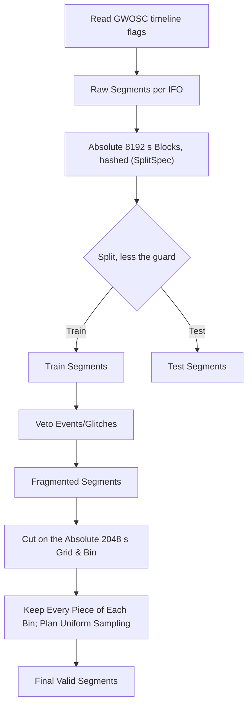

# Gravyflow Acquisition Process

This document provides a detailed explanation of the data acquisition process in `gravyflow`, specifically focusing on how the `IFODataObtainer` selects and splits time segments for noise and feature acquisition.

## High-Level Overview

The acquisition process is designed to retrieve valid, high-quality data segments from gravitational wave detectors (IFOs) like LIGO. The process ensures that:
1.  Every requested detector has data in the same 2048 s bin. Detectors are not intersected: in `RANDOM` order each example's detector windows start at least two footprints apart (`separated_starts`), so their data is never coincident in time. The opt-in `coincidence=gf.Coincidence.COINCIDENT` draws instead from the time every detector holds (each split's vetoed segments, intersected), every detector's window starting at one GPS time, in `RANDOM` and `GRID`. Every real-noise batch carries `ReturnVariables.COINCIDENT`, (B,): 1 where two or more of an example's detectors are read at one time.
2.  Data meets specific quality criteria (state flags).
3.  Time is split into train, validate and test by one absolute split, with a guard between splits.
4.  Unwanted periods are vetoed: every published event's footprint and guard always (events are test data, never noise, so a noise obtainer refuses `DataLabel.EVENTS`), and glitches unless asked for.
5.  For noise acquisition, every usable piece of data is used, and each detector's windows are drawn uniformly over its usable time in each bin.

## The Segment Selection Pipeline

The core logic resides in the `get_valid_segments` method of the `IFODataObtainer` class. Here is the step-by-step flow:

### 1. Initial Retrieval (`get_all_segment_times`)
The process begins by reading the public GWOSC timeline for each requested interferometer (e.g., H1, L1). No LVK credentials are needed.
-   **Input**: The GPS bounds of each observing run, from the GWOSC run API (O3 is GWOSC's O3a plus O3b), the detector (IFO), and the GWOSC flags to apply.
-   **Flags**: GWOSC defines each data-quality flag as the times that *pass* it, so applying a category means intersecting with its flag. The default (`gf.DEFAULT_GWOSC_FLAGS`) is `DATA` with `BURST_CAT1` and `BURST_CAT2` applied and without hardware injections: `NO_CBC_HW_INJ` ("no cbc injection"), `NO_BURST_HW_INJ` ("no burst injections"), `NO_STOCH_HW_INJ` ("no stoch injections") and `NO_DETCHAR_HW_INJ` ("no detchar injections") list the times with no injection, so they are intersected too (`gf.GWOSC_NO_HW_INJECTION_FLAGS`). The stochastic injections are coherent between H1 and L1. `NO_CW_HW_INJ` is not applied: continuous-wave injections run through nearly all of every run. `gwosc_flags=gf.GWOSC_BURST_FLAGS`, `gf.GWOSC_DATA_FLAGS` or `gf.GWOSC_CBC_FLAGS` selects others.
-   **Operation**: Returns a sorted, coalesced list of `[start, end)` time pairs where the detector passes every flag, over every configured run in any order.
-   **Cache**: Timeline segments are cached in `~/.gravyflow/cache/gwosc_timeline` (or `$GRAVYFLOW_CACHE_DIR`).
-   **Result**: A list of valid segments for *one* detector.

Livetime per option (days), measured from the GWOSC timeline:

| Run | IFO | `DATA` | `+BURST_CAT1` | `+BURST_CAT2` | `+NO_*_HW_INJ` (default) | default, after event and glitch vetoes | `DATA+CBC_CAT1+CBC_CAT2` |
|---|---|---|---|---|---|---|---|
| O1 | H1 | 76.70 | 76.70 | 76.22 | 76.19 | 75.59 | 75.89 |
| O1 | L1 | 65.81 | 65.81 | 65.78 | 65.75 | 64.39 | 65.80 |
| O2 | H1 | 157.81 | 157.81 | 157.24 | 157.22 | 155.37 | 157.38 |
| O2 | L1 | 153.96 | 153.96 | 153.56 | 153.55 | 150.37 | 153.72 |
| O3 | H1 | 245.21 | 245.21 | 243.53 | 243.53 | 237.33 | 244.70 |
| O3 | L1 | 251.93 | 251.93 | 250.47 | 250.47 | 240.86 | 251.47 |

Strain comes from the obtainer's data source, named explicitly (`source=`; `gf.Defaults.source` when it is not given). The default, `gf.GWOSC()`, downloads each run's bulk GWOSC release (`O3a_4KHZ_R1`, `O1_16KHZ` and so on; never an event release) through `TimeSeries.fetch_open_data`, at 4096 Hz when that suffices and at 16384 Hz otherwise. `gf.LocalFrames(frametypes={run: ...}, channels={run: ...}, sample_rate_hertz=...)` reads frames found by gwdatafind instead, by the frame type and channel it names for each GWOSC run (by default LVK's `HOFT_C01` frames of O3 and O4 at 16384 Hz), and plans only time where its frames are found. Nothing falls back from one source to another, and no frame type is switched for another: a fetch that fails raises `gf.StrainUnavailable`, naming the source, the detector, the interval and the cause, and a run a `LocalFrames` names no frame type for is refused by name. The source is part of the obtainer's specification, so of every fingerprint and cache key. Sample rates above the source's highest are refused: real data is never upsampled. Every read reaches its rate through one resampler, `gf.resample`: a polyphase Kaiser FIR (SciPy's `resample_poly`) that suppresses everything above the new Nyquist frequency by at least 100 dB, keeps the band up to 0.9 times it to within 1e-3, and puts sample n at exactly the first sample's time plus n over the rate. Rates must be whole hertz; any other is refused before a fetch.

### Glitch catalogue

Glitch times, classes and metadata (SNR, peak frequency, duration, confidence) come from the public Gravity Spy machine-learning classifications: Glanzer et al. 2023, *Class. Quantum Grav.* 40 065004, released on Zenodo (doi:10.5281/zenodo.5649212, v1.0.0, CC-BY-4.0). Please cite both if you use glitches from gravyflow. Each detector and run's file (16 to 216 MB) is downloaded on first use, checked against its published md5, and cached in compact form in `~/.gravyflow/cache/gravityspy`. The defaults keep every class except `No_Glitch`, with `ml_confidence >= 0.9`. Entries that overlap a published GW event's in-band signal are removed (`exclude_events=True`): Gravity Spy lists some real events as glitches, for example GW190521 (Blip_Low_Frequency) and GW200129_065458 (Chirp). Entries that overlap a hardware-injection gap (times with data that fail `NO_CBC_HW_INJ`, `NO_BURST_HW_INJ`, `NO_STOCH_HW_INJ` or `NO_DETCHAR_HW_INJ`; `gwosc_data.hardware_injection_gaps`) are removed from every class, and their number is logged (`exclude_hardware_injections=True`): many Chirps are CBC injections. The noise vetoes keep both kinds of entry, so noise is vetoed around every one.

### Event catalogue

Event times, source-frame chirp masses and parameter estimates (source-frame masses, luminosity distance, p_astro) come from every catalogue GWOSC's event API lists (https://gwosc.org/eventapi/json/), discovered from the API: the GWTC releases (confident, marginal and auxiliary, GWTC-4.0 onwards and the cumulative GWTC table) and the other lists GWOSC hosts, such as O3_IMBH_marginal, IAS-O3a, O3_Discovery_Papers, O4_Discovery_Papers and O1_O2-Preliminary (`gf.get_event_catalogue`). This is the one event list: the noise vetoes, the glitch catalogue's event exclusion, the event-time functions (`gf.get_all_event_times` and its kin) and the event examples with their parameters (`get_events_with_params`, `gf.search_events`) all read it. It is fetched once and cached in `~/.gravyflow/cache/gwosc_events`, with the GWOSC runs it was fetched under; it is fetched again when gravyflow's runs change. To pick up events GWOSC adds inside known runs, call `gf.get_event_catalogue(use_cache=False)`: it fetches the list afresh and rewrites the cache, which every later call, the vetoes among them, then reads.

An event listed by several catalogues is one record, merged by its catalogue name (`commonName`), the first catalogue's row kept. An event's source type follows from its median source-frame masses (`source_type_from_masses`): BNS if both are below 3 M☉, NSBH if one is, BBH otherwise, and `SourceType.UNKNOWN` (-1) when the catalogue gives no masses.

### 2. The Split (`gf.SplitSpec`)
One frozen `gf.SplitSpec`, held by the data obtainer (`split_spec=`, `gf.DEFAULT_SPLIT` when unset), decides which of `test`, `validate` and `train` every stretch of GPS time belongs to, for every route: noise, glitches, events, datasets, composed datasets and the validator (`gravyflow/src/dataset/splits.py`).
-   **Blocks**: GPS time is cut into absolute blocks of 8192 s counted from GPS 0, so block k is `[8192 k, 8192 (k + 1))` whatever runs are configured. A block's split is a sha256 hash of the spec's `version` and k, never of a seed or of the run list.
-   **Fractions**: test 10%, validate 10%, train 80% by default. The hash fills test from the bottom and validate from the top; train is the rest. Raising the test or validate fraction therefore takes blocks from train alone, and changing one of them never moves the other.
-   **Guard**: where two blocks of different splits meet, 128 s, half on each side of the edge, belongs to no split, so data of two splits is always at least 128 s apart. Joining two blocks of one split costs nothing.
-   **Noise** (`SplitSpec.admissible`): each detector's segments are intersected with the split's time (its blocks, less the guard at every edge with another split) before anything else.
-   **Transients** (`TransientIndex.assign_splits`): a record takes the split of its footprint, the time the library may read for it (48.2 s each side of a glitch; for an event, from its 20 Hz in-band start). A footprint that crosses an edge between splits or lies in a guard is in no split, and is counted. Real events are evaluation data: every confident event is in `test`, whatever its block, unless the obtainer is built with `train_on_real_events=True`, which needs `coincidence=gf.Coincidence.COINCIDENT` (an event is read at one time on every detector that observed it, and training on coincident data is the opt-in's alone). A glitch whose footprint meets an event's, or, outside `test`, comes within the guard of one, is in no split.
-   **Names**: a split is named `test`, `validate` or `train`, and every entry point needs one (`group=`); any other name, `'all'` among them, raises `KeyError`. A seed only orders a split, never decides its members.
-   **Fingerprint**: `SplitSpec.fingerprint()` names the spec in transient indexes and dataset metadata. A model gravyflow trains (a recipe's `TrainingRun`, or `gf.Model.train`) records the split its data reads, never one declared beside it: the fingerprint of its training and validation data's spec, which must be one spec, and the validation data's split, which selects the model, in `run.json` beside the model (`split_record`). The record belongs to the weights: every model gravyflow trains or loads carries it, and weights that carry one never train on another split. Training data that names no split, a resumed run's data split otherwise, or weights recording another split, is refused. The validator reads the model's record and refuses a model split by another spec than the data it scores and the split that selected it; a model gravyflow never trained has no record and is scored with a warning. A custom `version` gives an independent split, for cross-validation.

### 4. Vetoing Unwanted Times (`remove_unwanted_segments`)
Unless the data labels include them, every event GWOSC publishes (see the event catalogue above) and every Gravity Spy glitch is removed from noise, over every configured run.
-   **Events** (`get_event_veto_segments`): each event's whole signal in band, `[t - 1.25 tau - 2 s, t + 2 s]`, where `tau` is the leading-order time from 20 Hz to merger for the event's source-frame chirp mass (an upper bound on the observed duration). GW170817 is vetoed from 208 s before its merger. The factor 1.25 makes every catalogued event's veto at least as long as LALSuite's chirp-time bound at maximal spins. Events without published masses (for example the O3_IMBH_marginal candidates) are treated as a 1 + 1 solar-mass binary (about 6 minutes). Confident, marginal and auxiliary events, and other pipelines' candidates, are all vetoed. Each event's footprint (the time an example of it may read, `[t - max(48.2 s, tau + 1 s), t + 48.2 s]`) is vetoed too, widened by the split's 128 s guard: events are test data, so no noise comes within the guard of them.
-   **Glitches** (`get_glitch_veto_segments`): every Gravity Spy entry, whatever its class or classification confidence (each is an Omicron trigger above SNR 7.5), over its whole Omicron extent `[start_time, start_time + duration]` plus 1 s on each side, 3 s for Extremely_Loud. Measured in public strain on 2,535 glitches of every class, the excess power reaches beyond the Omicron extent by at most 0.44 s for 99% of glitches; 99.88% lie within 1 s, the 99.9th percentile is 1.02 s, and the only glitches beyond 1.25 s were Extremely_Loud, up to 2.5 s.
-   **Operation** (`veto_time_segments`): both lists are sorted and coalesced (pieces of zero length dropped), then the vetoes are subtracted from the segments, splitting a segment where a veto falls inside it.

### 5. Noise Acquisition Specifics (`cut_segments`, `merge_bins` & `all_segments_per_bin`)
-   **Binning**: Segments are cut on an absolute grid of `max_segment_duration_seconds` (2048 s by default): bin k is `[2048 k, 2048 (k + 1))` in GPS, whatever runs are configured. A contiguous stretch of data therefore yields whole 2048 s segments, except where a guard (section 2) trims the bin at an edge between splits: the 8192 s blocks are whole bins, so no bin is in two splits.
-   **Merging (`merge_bins`)**: Each detector's pieces are grouped into these bins; bins where some requested detector has no data are dropped.
-   **Selection (`all_segments_per_bin`)**: Every piece of every bin is kept, as rows of one piece per detector. Each detector's pieces, longest first, tile the bin's share in proportion to their lengths, and each row takes the pieces whose tiles overlap (`couple_pieces`): the longest pieces go together, and a detector with fewer pieces shares one piece among several rows. The pieces of a row need not overlap in time.
-   **Result**: An array of shape `(rows, detectors, 2)` of `[start, end]` pairs.
-   **Sampling (`plan_sampling`)**: Once the window is known, each detector's pieces shorter than twice the window are set aside, and the usable pieces of each bin are paired again, now in proportion to their window starts (a piece's interior as it is read, the whole seconds whose read lies inside it (`store.read.interiors`), less the window's footprint). Each detector's windows are thus drawn uniformly over the starts of all its usable pieces in the bin: no usable piece is dropped and no short piece is sampled more densely than a long one. The bin's number of examples is set by the detector with the fewest starts, which is sampled at the nominal density (saturation examples per onsource duration); the others are sampled at or below it. Each pass, a row accrues its expected number of batches and is due the whole batches it has accrued, the fraction carried to the next pass (accruals start at a random fraction), so every row is drawn at its expected rate, and a pass in which no row is due does not end the data. A bin where some detector has no usable piece is skipped. A row whose detectors' windows cannot start two footprints apart is left out and counted (`separable`). `RANDOM` draws each detector's start over its whole piece, given the other detectors' starts, from the starts at least two footprints from theirs (`separated_starts`); when no row of the split can hold a batch of such windows, the generator raises `ValueError` rather than spin. `GRID` makes one pass over the plan's rows, in order, and then ends: it draws nothing and ignores the saturation. Each detector's piece is cut into slots one padded onsource apart, and each slot is served at most once a pass, though its piece is in several rows. In each row, the first detector's free slots are taken in order, and each other detector takes its first free slot, scanning cyclically from half its slots on, at least two footprints from the example's other windows (`grid_starts`); a slot with no such partner is not served. A row thus serves as many examples as it has separated slots left. Examples are batched across rows, and the last, partial batch is not served. The obtainer's iterator then ends; a `Dataset` asked for a batch beyond the pass raises, naming the exhausted reader (`ReaderExhausted`).

### Loading segments: the strain store
Real noise is read through gravyflow's strain store (`dataset/store`), never fetched for a segment alone. The store keeps the source's own files: for `gf.GWOSC()`, its 4096 s bulk files on the GPS grid, raw, at the native rate fetched, each written once and whole, and never changed, under `~/.gravyflow/cache/store/` (or `$GRAVYFLOW_CACHE_DIR/store`). A stored file is named by its source's strain (`DataSource.source_id`), detector, rate and time alone, so every rate, split and configuration of one source reads the same files, and a warm read equals a cold one. A read of a piece takes the stored files its span covers, fetching any not yet stored, as a memory-mapped view; resamples it with `gf.resample`; and cuts the resampler's margin from each end (about 0.03 s at 2048 Hz from 4096 Hz), so every sample served is exact. A piece is read as its interior: from the first sample, on the grid both rates share, whose read lies inside the piece, for the whole seconds that fit, so no read reaches outside the time it was planned from, and the number of distinct piece lengths stays bounded (the sampling plan measures each piece by the same interior). On the GWOSC timeline (O1 to O3, H1 and L1, each detector alone, at 2048 Hz), the noise available in pieces of at least 36 s rose from 9,458 h to 21,275 h, with the event and glitch vetoes now applied (with them applied to the previous binning, 5,780 h).

Each piece keeps the GPS time of its first sample, and every window's GPS time is counted from it, never from the segment's nominal start. The timeline is the authority on which time holds data: a fetch that fails after three tries, or a read that meets samples the source's file did not cover or that are non-finite, contradicts it and is refused by name (`TimelineContradiction`, a `gf.StrainUnavailable`), naming the detector, the interval, the source, the cause and the `exclusions` entry that would plan around it. Nothing is zero-filled, and a failed fetch stores nothing. `exclusions=[(detector, (start, end), reason), ...]`, an obtainer parameter in its fingerprint, takes those times from the detector's readable time (`get_all_segment_times`) before anything is planned. The store's format is a data version (`DATA_VERSIONS["store"]`) and names its root, so a new format never reads an old one; real-noise segment caches of earlier versions (`segments/`) are never read, and are named once, with their sizes. A process holds at most `gf.Defaults.memory_bytes` (2 GiB by default) in downloads and reads at once; one larger than the cap is refused before any fetch. `Store.verify()` checks every stored file in full and lists samples no record names; `Store.forget` is the store's only deletion.

### Labels
`START_GPS_TIME` is, for each example and detector, the GPS time of the first sample of the onsource window returned after cropping (`WindowSpec.onsource_start_gps`), in float64. When the onsource is returned uncropped (an obtainer called without `crop=True`), its first sample is `crop_duration_seconds` earlier.

Transient windows follow the same rule. A transient's padded onsource is centred on the transient's sample, the sample of the absolute grid at the requested rate nearest its catalogue time, so `START_GPS_TIME` is exact (`WindowSpec.transient_window_start_gps`); `TRANSIENT_GPS_TIME` is, per detector, the centre that detector was read at: the transient's own time, or its partner time (below). Its offsource ends where the padded onsource begins, as for noise. Each detector's offsource and padded onsource are one read through the store, as noise is (`store.read`): a view of the source's tiles, the one resampler, the margin cut away, so every sample served is exact, at any whole rate the source can make. A record may be read 48.2 s each side of its transient (its span); a request whose read, the resampler's margin counted, could reach past that span is refused by name before any fetch: at 2048 Hz the offsource plus half the padded onsource may be at most about 48.17 s.

### Transient detectors and partners
An example of a transient reads each requested detector once, and never two detectors at one time but for an event seen in several. The transient's own detectors, `seen_in`, are read at its time: a glitch's are those Gravity Spy saw it in; an event's are found from data quality, each requested detector whose usable data holds the event's whole span (the catalogue does not say which detectors observed it), and an event seen in none is not served (`"data quality"`). Each other requested detector is read at a partner time of its own (`partners.partner_time`): a centre on a 4096 Hz grid (`PARTNER_GRID_HERTZ`) whose span, as long as the record's, lies in that detector's usable data in the record's split (`SplitSpec.admissible`), less every event's footprint and guard and every one of that detector's Gravity Spy glitches (as noise is vetoed); inside one block of the record's split (8192 s by default): a glitch's own block, and an event's nearest block of its split in its observing run (its own block when that is one; else the nearer out, the earlier at equal distance), since an event is in `test` whatever its block's split, so an event's partner is test time; and at least two footprints (192.8 s for a glitch) from the transient's time. Among those centres the partner is chosen by a hash of the split's fingerprint, the transient's time and the detector, so a record has the same partner in every build and epoch, drawn from no random state. A partner is labelled noise on its detector: `DATA_LABEL` NOISE, `SUB_TYPE`, `GLITCH_TYPE` and `SOURCE_TYPE` -1, and its own `TRANSIENT_GPS_TIME` and `START_GPS_TIME`. A record with no partner time on a detector it needs is not served, and is counted as `"no partner"`. `COINCIDENT` is 1 for an example with two or more detectors read at the transient's time (an event seen in several), else 0.

Under the opt-in, `coincidence=gf.Coincidence.COINCIDENT`, every requested detector is read at the transient's time and must hold its span in its usable data; a detector the transient was not seen in is labelled noise, and a record whose span there meets one of that detector's Gravity Spy glitches is not served, counted as `"transient in another detector"`.

### Transient data quality
A transient is planned only when its span lies, on every detector it is read on at its own time, inside one of the detector's readable segments (`get_all_segment_times`: the obtainer's GWOSC flags, by default with no hardware injections, less its `exclusions`). A partner's data quality is its partner time's: it lies in the detector's noise-admissible data by construction. A transient that fails a check is not planned, and `get_acquisition_stats()["rejections"]` counts it once by reason (`"data quality"`, `"no partner"`, `"transient in another detector"`). Nothing is zero-filled or skipped after that: a planned transient whose strain the source does not deliver (its fetch fails after three tries, or its samples are not finite) is refused by name, `TransientUnavailable` (a `gf.StrainUnavailable`), naming the transient, the detector, the source, the cause and the `exclusions` entry that plans around it. A failed fetch stores nothing, so it never persists as absence: the next run fetches it again. A `validate` or `test` split is one pass, each transient once and unweighted, then the end: its examples are a set, never a sample. Every pass serves each transient it draws or refuses it, so no pass is empty and no split is iterated forever.

### Transient strain
Transient strain is kept where noise strain is, in the store under the cache root: whole tiles of the source's own files, at its native rate, fetched once and shared by every request, rate, split and configuration. Nothing else is kept: there is no transient window cache, no row index, and gwpy's own download cache is off. Tiles carry no row identity to go stale, so two transients within 10 ms of each other, or a store another process forgets and refills, each serve their own strain. By default a detector is never read at a glitch's time unless the glitch was seen there. Window caches an earlier gravyflow wrote (`glitch_cache_v*.h5`, `event_cache_v*.h5`, `partner_cache_v*.h5`) and its download cache (`astropy/`) are never read: the first read names them, once, with their sizes, so they can be deleted.

### 6. Final Ordering (`order_segments`)
Finally, the segments are ordered based on the user's preference:
-   **Random**: Shuffled for training variety.
-   **Chronological**: Useful for sequential analysis.
-   **Shortest First**: Sometimes used for debugging.

## Summary Diagram

This rigorous process ensures that the data fed into the machine learning model is clean, consistent, and strictly separated by dataset split.
